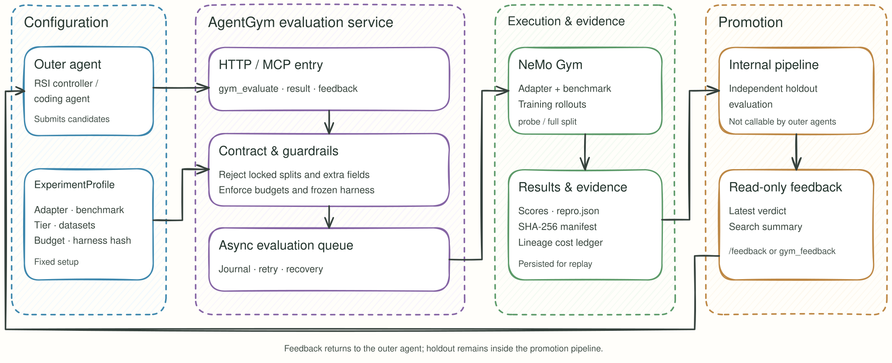

<h1 align="center">AgentGym</h1>

<h3 align="center">Make every evaluation in a self-improvement loop trustworthy, controlled, and reproducible.</h3>

<p align="center">An RSI evaluation service for heterogeneous agents and compute environments: submit candidates, run Gym rollouts, and use governed results to guide the next iteration.</p>

<p align="center">
  =3.13.14">
  
  
</p>

<p align="center">English | <a href="./README.zh-CN.md">中文</a></p>

<p align="center">
  <a href="#when-to-use">When to use</a> · <a href="#overview">Overview</a> ·
  <a href="#architecture">How it works</a> · <a href="#capabilities">Guardrails and API</a> ·
  <a href="#installation">Installation</a> · <a href="#usage">Quick start</a> ·
  <a href="#ecosystem">Ecosystem</a> · <a href="#guides">Guides</a>
</p>

<a id="when-to-use"></a>

## 🎯 When to use AgentGym

Use AgentGym when an outer agent repeatedly proposes candidates and needs consistent evaluation rules, bounded costs, and an auditable record of each result.

| Scenario | What to prepare | What AgentGym provides |
| --- | --- | --- |
| **Improve an agent harness** | Candidate artifacts, tasks, an adapter, and a benchmark profile. | Probe or full training split evaluations with results and cost records. |
| **Select RSI candidates** | Training data, optional holdout data, evaluation tiers, and budgets. | Training results for screening; once a candidate is frozen, the host release controller triggers a loopback-only `/promotion` holdout run and compares the aggregate report against the incumbent. |
| **Compare heterogeneous environments** | A harness such as DSH, Codex, or Claude Code and its benchmark configuration. | One service contract for NeMo Gym rollouts, with reproducibility evidence. |

<a id="overview"></a>

## ℹ️ Overview

AgentGym builds on the pinned `nemo-gym==0.7.0` wheel. The `overlay/` directory holds owned and customized components; `eval_service/` exposes NeMo Gym rollouts to RSI controllers and coding agents.

- **One service core.** HTTP routes and MCP tools share the same evaluation logic. An asynchronous queue, journal, and persisted results support polling and recovery after a restart.
- **Governed experiments.** An ExperimentProfile fixes the adapter, benchmark, tier, data, and budgets. Requests accept only fields permitted by the contract.
- **Auditable decisions.** A training probe alone cannot justify promotion. Harness manifests, reproduction records, and a lineage cost ledger preserve the conditions of each evaluation.

<a id="architecture"></a>

## 🔄 How it works

### Architecture overview



1. **Define an experiment.** Configure the adapter, benchmark, tier, budgets, and training data in an ExperimentProfile. Register holdout data if the experiment needs promotion decisions.
2. **Submit a candidate.** Call `/gym_evaluate` or the matching MCP tool. The contract rejects unauthorized splits, budget violations, and unknown fields; accepted work enters the asynchronous queue.
3. **Run and record.** NeMo Gym executes the rollout. The service persists results, `repro.json`, the journal, and lineage costs.
4. **Read the outcome.** `/results` retrieves an evaluation. Once a candidate is frozen, the host release controller calls the loopback-only `POST /promotion`; Gym runs the locked holdout and returns an aggregate report. `/feedback` only reads existing reports and never starts a rollout. Outer callers cannot request holdout directly.

<a id="capabilities"></a>

## 🛡️ Guardrails and API

| Guardrail | Enforcement |
| --- | --- |
| **OF: overfitting protection** | `train_probe` is for screening; holdout is reachable only through the loopback-only `/promotion` control plane, never through `/gym_evaluate` or MCP. |
| **EC: evaluation cost control** | Tier presets, concurrency and budget limits, and a lineage cost ledger bound usage; failed rollouts are accounted for. |
| **HF: harness freeze** | A content-addressed SHA-256 manifest identifies changes to evaluation configuration. |

| HTTP | MCP tool | Purpose |
| --- | --- | --- |
| `POST /gym_evaluate` | `gym_evaluate` | Submit an evaluation. |
| `POST /results` | `gym_eval_result` | Retrieve a result by `eval_id`. |
| `POST /feedback` | `gym_feedback` | Read an existing promotion report by `candidate_id`; never starts holdout. |
| `POST /promotion`, `GET /promotion/{id}` | — | Loopback-only host control plane: run or poll the locked holdout for one candidate digest and benchmark. |
| `POST /pending`, `POST /tasks` | — | Inspect pending work and task metadata. |

The contract lives in [`eval_service/contract.py`](eval_service/contract.py). Business-rule rejections return HTTP 200 with `status=rejected`; a request body that fails Pydantic model validation returns HTTP 422. `/promotion` rejects `split` and `task_ids`.

<a id="installation"></a>

## 📦 Installation

Requirements: Linux, macOS, or WSL; [uv](https://docs.astral.sh/uv/); Python **>= 3.13.14** (as specified in `pyproject.toml`).

```bash
git clone https://github.com/evolving-foundry/ember-gym.git
cd AscendAgent-Gym
./scripts/install-dev.sh
agent-gym doctor --overlay --entrypoints --json
```

The script syncs locked dependencies, installs this project, and checks command entry points. For manual installation:

```bash
uv sync --no-install-project --extra dev --extra sandbox
uv pip install --no-deps -e .
```

`agent-gym` is the primary command. `gym`, `ng`, and existing `nemo_gym_*` commands route through compatibility entry points.

<a id="usage"></a>

## 🛠️ Quick start

### 1. Prepare benchmark data

Runtime datasets are not committed to the repository. Preview the preparation commands, then prepare the benchmarks you need:

```bash
bash scripts/prepare_data.sh --dry-run all
bash scripts/prepare_data.sh prepare gsm8k
bash scripts/prepare_data.sh collate gsm8k
bash scripts/prepare_data.sh render gsm8k
```

For a materialized RSI split, run `bash scripts/prepare_data.sh rsi arc-agi`. The full `bash scripts/prepare_data.sh all` workflow requires internet access and credentials for some datasets. Do not run preparation jobs concurrently.

### 2. Start the evaluation service

```bash
python -m eval_service.server \
  --profile-path eval_service/profiles/rsi_v0_gsm8k_e2e.yaml \
  --results-root ./results \
  --ledger-path ./results/ledger.json
```

This GSM8K end-to-end profile has no registered holdout, so `/promotion` cannot produce a holdout verdict. Configure its model, data, and runtime before submitting work.

### 3. Submit and inspect an evaluation

```bash
curl -X POST http://127.0.0.1:8399/gym_evaluate \
  -H 'Content-Type: application/json' \
  -d '{"candidate_id":"iter-042-cand-07","adapter":"dsh","benchmark":"gsm8k","split":"train_probe","tier":"probe","seed":42}'

# Use the eval_id returned above; poll again if the status is queued.
curl -X POST http://127.0.0.1:8399/results \
  -H 'Content-Type: application/json' \
  -d '{"eval_id":"<EVAL_ID>"}'

# Read an existing promotion report (read-only; does not start holdout).
curl -X POST http://127.0.0.1:8399/feedback \
  -H 'Content-Type: application/json' \
  -d '{"candidate_id":"iter-042-cand-07"}'

# Once the candidate is frozen, the host release controller triggers holdout
# (loopback-only; not exposed as an MCP tool).
curl -X POST http://127.0.0.1:8399/promotion \
  -H 'Content-Type: application/json' \
  -d '{
    "candidate_id": "iter-042-cand-07",
    "candidate_digest": "sha256:<64-hex>",
    "adapter": "dsh",
    "benchmark": "gaia_text_validation",
    "tier": "full",
    "seed": 42
  }'

# Poll the aggregate report; one holdout per experiment identity
# (candidate_digest + benchmark + adapter + tier + evaluation_digest; seed is excluded).
curl http://127.0.0.1:8399/promotion/<PROMOTION_ID>
```

MCP clients can connect to `http://127.0.0.1:8399/mcp` and use `gym_evaluate`, `gym_eval_result`, and `gym_feedback`. For a single rollout, use `gym eval run --no-serve`.

`seed` is a run-identity/replay anchor: it participates in `eval_id` and `repro.json` but does not change `train_probe` selection. Whether it becomes a decoder seed depends on the backend; the evaluation service does not fabricate a top-level `--seed`.

When submitted through an RSI evaluator plugin, the plugin hashes the candidate bundle tree and sends it as `candidate_digest`; hosts calling HTTP directly should do the same. It participates in `eval_id`, `repro.json`, the ledger, and the promotion report. MCP `gym_evaluate` deliberately does not expose it, so outer agents cannot forge content identity.

<a id="ecosystem"></a>

## 🧩 Benchmarks and agent ecosystem

`overlay/` maintains owned and customized benchmarks, resource servers, agents, and models. Representative components include:

| Area | Examples |
| --- | --- |
| Math and knowledge reasoning | GSM8K, IOI / IOI26, UGPhysics, AaLcR, Omniscience, SimpleQA |
| Abstract reasoning | ARC-AGI v1 / v2 / v3 |
| Long-horizon agent tasks | GAIA, AssistantBench, WebArena-Verified, WorkArena, OSWorld, Terminal-Bench 2.1, SWE-bench, Tau2, BrowseComp, GDPval |
| Safety and synthetic domains | Aegis v4, NPU fault diagnosis, office, terminal, document, and OCR tasks |
| Agent adapters | DSH, Claude Code, Codex, Hermes, OpenCode, Terminus-2, BrowserGym, and others |

See [`eval_service/profiles/`](eval_service/profiles/) for experiment combinations and each benchmark's documentation for data and dependency setup.

<a id="guides"></a>

## 📖 Guides and provenance

- [Direct RSI benchmark boundaries](overlay/benchmarks/rsi_direct/README.md)

AgentGym consumes a precisely pinned [NVIDIA NeMo Gym](https://github.com/NVIDIA-NeMo/Gym) wheel. Project behavior lives in `agent_gym/`, `eval_service/`, and `overlay/`; the upstream framework source is not vendored. Runtime data is not committed. The project is licensed under [Apache-2.0](LICENSE); see [ATTRIBUTIONS.md](ATTRIBUTIONS.md) for third-party notices.
