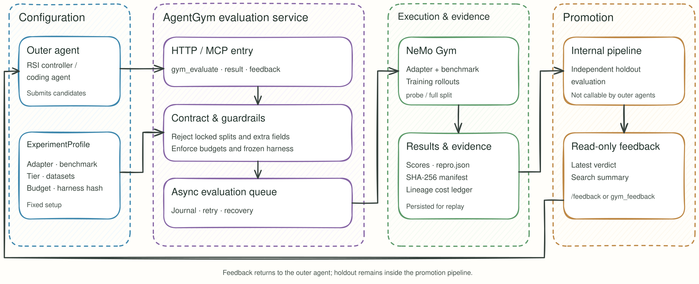

<h1 align="center">AgentGym</h1>

<h3 align="center">让自改进循环中的每一次评估可信、可控、可复现。</h3>

<p align="center">面向异构 Agent 与加速环境的 RSI 评估服务：提交候选、运行 Gym rollout，并依据受控的评估结果决定下一步。</p>

<p align="center">
  =3.13.14">
  
  
</p>

<p align="center"><a href="./README.md">English</a> | 中文</p>

<p align="center">
  <a href="#when-to-use">适用场景</a> · <a href="#overview">项目概览</a> ·
  <a href="#architecture">架构与流程</a> · <a href="#capabilities">核心能力</a> ·
  <a href="#installation">安装</a> · <a href="#usage">快速开始</a> ·
  <a href="#ecosystem">组件生态</a> · <a href="#guides">文档</a>
</p>

<a id="when-to-use"></a>

## 🎯 什么时候使用 AgentGym

当外层 Agent 持续提出候选，并需要以相同规则比较效果、控制评估开销和审计历史结果时，AgentGym 可作为统一评估入口。

| 场景 | 准备工作 | AgentGym 提供什么 |
| --- | --- | --- |
| **优化 Agent harness** | 准备候选、任务数据、adapter 与 benchmark profile。 | 对候选进行 probe 或完整训练集评估，记录结果与成本。 |
| **筛选 RSI 迭代结果** | 配置训练与可选 holdout 数据、评估 tier 和预算。 | 训练集成绩用于筛选；候选冻结后由宿主 release controller 调用 loopback-only `/promotion` 运行 holdout，并基于聚合报告与 incumbent 比较。 |
| **比较异构执行环境** | 选择 DSH、Codex、Claude Code 等 harness，以及对应 benchmark 配置。 | 让不同候选经同一服务契约进入 NeMo Gym rollout，并保留复现证据。 |

<a id="overview"></a>

## ℹ️ 项目概览

AgentGym 基于锁定版本的 `nemo-gym==0.7.0` wheel 构建。仓库中的 `overlay/` 提供自有及定制组件，`eval_service/` 将 NeMo Gym rollout 包装为供 RSI 控制器和编码 Agent 调用的评估服务。

- **统一入口。** HTTP 路由与 MCP 工具调用同一服务核心；异步队列、journal 和落盘结果支持提交后查询及重启后回放。
- **受控实验。** ExperimentProfile 固定 adapter、benchmark、tier、数据集和预算；请求只接受契约允许的字段。
- **可审计结论。** 训练集 probe 不能直接成为晋升依据；harness manifest、复现记录和谱系成本账本记录评估条件。

<a id="architecture"></a>

## 🔄 架构与工作方式

### 框架概览



1. **定义实验。** 在 ExperimentProfile 中配置 adapter、benchmark、tier、预算以及训练数据；有晋升需求时额外注册 holdout 数据。
2. **提交候选。** 外层调用 `/gym_evaluate` 或同名 MCP 工具。契约拒绝越权 split、预算或未知字段；合法请求进入异步队列。
3. **运行与记录。** NeMo Gym 执行 rollout；服务保存评估结果、`repro.json`、journal 和谱系成本记录。
4. **读取结论。** `/results` 返回评估结果。候选冻结后，宿主 release controller 调用 loopback-only `POST /promotion`，由 Gym 运行锁定的 holdout 并返回聚合报告；`/feedback` 只读取已有报告，不会触发新的 rollout。外层调用方不能直接请求 holdout。

<a id="capabilities"></a>

## 🛡️ 核心约束与接口

| 约束 | 执行方式 |
| --- | --- |
| **OF：过拟合防护** | `train_probe` 只用于粗筛；holdout 只能通过 loopback-only `/promotion` 控制面触达，`/gym_evaluate` 与 MCP 均不可达。 |
| **EC：成本控制** | tier preset、并发与预算上限、谱系成本账本约束评估开销；失败的 rollout 也计入账本。 |
| **HF：harness 冻结** | 内容寻址的 SHA-256 manifest 标识评估配置变化，保证前后结果可比。 |

| HTTP | MCP 工具 | 用途 |
| --- | --- | --- |
| `POST /gym_evaluate` | `gym_evaluate` | 提交评估。 |
| `POST /results` | `gym_eval_result` | 按 `eval_id` 查询结果。 |
| `POST /feedback` | `gym_feedback` | 按 `candidate_id` 读取已有晋升报告；不触发 holdout。 |
| `POST /promotion`、`GET /promotion/{id}` | — | 宿主专用 loopback 控制面：按实验身份（candidate_digest + benchmark + adapter + tier + evaluation_digest）运行或轮询锁定的 holdout。 |
| `POST /pending`、`POST /tasks` | — | 查看队列与任务元数据。 |

服务端契约见 [`eval_service/contract.py`](eval_service/contract.py)。业务规则拒绝以 HTTP 200 和 `status=rejected` 返回；请求体不符合 Pydantic 模型时返回 HTTP 422。`/promotion` 不接受 `split`/`task_ids`。

<a id="installation"></a>

## 📦 安装

要求：Linux、macOS 或 WSL；[uv](https://docs.astral.sh/uv/)；Python **>= 3.13.14**（以 `pyproject.toml` 为准）。

```bash
git clone https://github.com/evolving-foundry/ember-gym.git
cd AscendAgent-Gym
./scripts/install-dev.sh
agent-gym doctor --overlay --entrypoints --json
```

安装脚本依次同步锁定依赖、安装本项目并检查命令入口。需要手动安装时：

```bash
uv sync --no-install-project --extra dev --extra sandbox
uv pip install --no-deps -e .
```

`agent-gym` 是主命令；`gym`、`ng` 和既有 `nemo_gym_*` 命令通过兼容入口运行。

<a id="usage"></a>

## 🛠️ 快速开始

### 1. 准备 benchmark 数据

仓库不提交运行数据。先预览命令，再按需准备 benchmark：

```bash
bash scripts/prepare_data.sh --dry-run all
bash scripts/prepare_data.sh prepare gsm8k
bash scripts/prepare_data.sh collate gsm8k
bash scripts/prepare_data.sh render gsm8k
```

RSI profile 需要 materialized split 时可运行 `bash scripts/prepare_data.sh rsi arc-agi`。完整准备流程为 `bash scripts/prepare_data.sh all`，需要公网，部分数据需要凭证；不要并发运行 prepare。

### 2. 启动评估服务

```bash
python -m eval_service.server \
  --profile-path eval_service/profiles/rsi_v0_gsm8k_e2e.yaml \
  --results-root ./results \
  --ledger-path ./results/ledger.json
```

此示例 profile 用于 GSM8K 端到端评估，未注册 holdout，因此 `/promotion` 无法给出该 profile 的晋升结论。按 profile 配置好模型、数据与运行环境后再提交请求。

### 3. 提交并查询评估

```bash
curl -X POST http://127.0.0.1:8399/gym_evaluate \
  -H 'Content-Type: application/json' \
  -d '{"candidate_id":"iter-042-cand-07","adapter":"dsh","benchmark":"gsm8k","split":"train_probe","tier":"probe","seed":42}'

# 用提交响应中的 eval_id 查询；queued 时继续轮询
curl -X POST http://127.0.0.1:8399/results \
  -H 'Content-Type: application/json' \
  -d '{"eval_id":"<EVAL_ID>"}'

# 读取已有晋升报告（只读；不会触发 holdout）。
curl -X POST http://127.0.0.1:8399/feedback \
  -H 'Content-Type: application/json' \
  -d '{"candidate_id":"iter-042-cand-07"}'

# 候选冻结后，由宿主 release controller 触发 holdout
# （loopback-only；不注册为 MCP tool）。
curl -X POST http://127.0.0.1:8399/promotion \
  -H 'Content-Type: application/json' \
  -d '{
    "candidate_id": "iter-042-cand-07",
    "candidate_digest": "sha256:<64-hex>",
    "adapter": "dsh",
    "benchmark": "gaia_text_validation",
    "tier": "full",
    "seed": 42
  }'

# 轮询聚合报告；同一实验身份（candidate_digest + benchmark + adapter + tier +
# evaluation_digest，seed 不参与）只允许一次 holdout。
curl http://127.0.0.1:8399/promotion/<PROMOTION_ID>
```

MCP 客户端可连接 `http://127.0.0.1:8399/mcp`，使用 `gym_evaluate`、`gym_eval_result` 和 `gym_feedback`。单次 rollout 调试可使用 `gym eval run --no-serve`。

`seed` 是评估运行的幂等/复现锚点：它参与 `eval_id` 和 `repro.json`，不会改变 `train_probe` 的选题。是否作为模型解码 seed 取决于后端能力，评估服务不会伪造一个顶层 `--seed`。

经 RSI evaluator 插件提交时，插件会计算候选 bundle 文件树的 SHA-256，作为 `candidate_digest` 一并提交；直接走 HTTP 的 host/controller 也应发送该字段。它参与 `eval_id`、`repro.json`、ledger 和 promotion report。MCP `gym_evaluate` 刻意不暴露它，避免外层 Agent 伪造内容身份。

<a id="ecosystem"></a>

## 🧩 Benchmark 与 Agent 生态

`overlay/` 维护自有和定制的 benchmark、resource server、Agent 与 model 组件；以下为代表性组合。

| 类型 | 示例 |
| --- | --- |
| 数学与知识推理 | GSM8K、IOI / IOI26、UGPhysics、AaLcR、Omniscience、SimpleQA |
| 抽象推理 | ARC-AGI v1 / v2 / v3 |
| 长程 Agent 任务 | GAIA、AssistantBench、WebArena-Verified、WorkArena、OSWorld、Terminal-Bench 2.1、SWE-bench、Tau2、BrowseComp、GDPval |
| 安全与领域合成 | Aegis v4、NPU 故障诊断、办公、终端、文档与 OCR 合成 |
| Agent adapter | DSH、Claude Code、Codex、Hermes、OpenCode、Terminus-2、BrowserGym 等 |

可用实验组合见 [`eval_service/profiles/`](eval_service/profiles/)；具体数据准备与依赖以相应 benchmark 文档为准。

<a id="guides"></a>

## 📖 文档与来源

- [RSI benchmark 运行边界](overlay/benchmarks/rsi_direct/README.md)

AgentGym 使用精确锁定的 [NVIDIA NeMo Gym](https://github.com/NVIDIA-NeMo/Gym) wheel；本项目行为位于 `agent_gym/`、`eval_service/` 和 `overlay/`。框架源码不随仓库 vendored。运行数据不进入 Git。项目采用 [Apache-2.0](LICENSE) 许可，第三方声明见 [ATTRIBUTIONS.md](ATTRIBUTIONS.md)。
